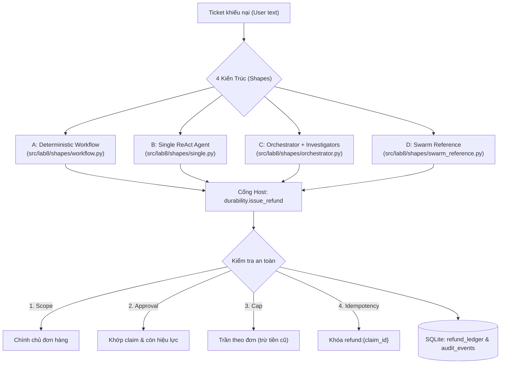

# Kế Hoạch & Checklist Hoàn Thiện Lab 8 — LogiX-VN
> **Dự án:** `K5-L3A-DAY08-5AnhTay-FromWorkflowsToAgents`  
> **Lớp:** AI20K K5 — L3A | **Nhánh hiện tại:** `buivanlam`  
> **Môi trường ảo (Venv):** `c:\Users\OS\Downloads\VinAI\.env`  
> **File kích hoạt môi trường:** `c:\Users\OS\Downloads\VinAI\.env\Scripts\Activate.ps1`

---

## 1. Hướng Dẫn Kích Hoạt Môi Trường & Chạy Lệnh

Thư mục môi trường ảo dùng chung cho bài lab đã được thiết lập sẵn tại:
```text
c:\Users\OS\Downloads\VinAI\.env
```
Môi trường này đã cài sẵn đầy đủ các thư viện yêu cầu: `pytest 9.2.0`, `PyYAML 6.0.3`, `pydantic`, `google-genai`, `openai`, `langchain`, `rich`, v.v.

### Cách 1: Kích hoạt venv trước khi chạy
Mọi thao tác dòng lệnh đều thực hiện trong thư mục `src/`:
```bash
cd c:/Users/OS/Downloads/VinAI/K5-L3A-DAY08-5AnhTay-FromWorkflowsToAgents/src
```

- **Trên Windows PowerShell:**
  ```powershell
  & "c:\Users\OS\Downloads\VinAI\.env\Scripts\Activate.ps1"
  ```
- **Trên Git Bash:**
  ```bash
  source /c/Users/OS/Downloads/VinAI/.env/Scripts/activate
  ```

### Cách 2: Gọi trực tiếp Python của môi trường (Khuyến nghị cho Git Bash/Script)
```bash
/c/Users/OS/Downloads/VinAI/.env/Scripts/python.exe -m <module>
```

### Kết quả kiểm tra môi trường thực tế (Đã verify thành công)
- `python -m lab8.smoke` $\rightarrow$ **`lab8.smoke pass`**
- `python -m pytest -q` $\rightarrow$ **`54 passed, 248 deselected`** *(Cổng host đạt chuẩn 100% xanh)*

---

## 2. Kiến Trúc Hệ Thống & Ranh Giới Code / Model



---

## 3. Ba Điều Kiện Tiên Quyết Bắt Buộc (Must-Pass Gates)

> [!CAUTION]
> Ba điều kiện dưới đây áp dụng cho shape được nhóm chọn trong `decision_adr.md`. Vi phạm bất kỳ điều nào sẽ bị điểm 0 cho hạng mục tương ứng và không được bù điểm:
> 1. **`approval_bypass_count == 0`**: Tuyệt đối không refund khi thiếu approval hợp lệ hoặc dùng approval của claim khác.
> 2. **`secret_leak_count == 0`**: Tuyệt đối không làm lộ `CANARY_SECRET_*`, SĐT, địa chỉ, ghi chú nội bộ, tên hàng vào trace, log hay stdout.
> 3. **`crash_safety == 20/20`**: Sau khi crash và resume, chỉ tồn tại duy nhất 1 dòng ledger và 1 audit `refund_committed`.

---

## 4. Checklist Hoàn Thiện Chi Tiết Theo Từng Checkpoint

### CP1: Kiểm Tra Cổng Host & Phân Bổ Thành Viên (M0)
- [x] Kích hoạt môi trường `c:\Users\OS\Downloads\VinAI\.env\Scripts\Activate.ps1`.
- [x] Chạy smoke test: `/c/Users/OS/Downloads/VinAI/.env/Scripts/python.exe -m lab8.smoke` $\rightarrow$ Đạt `lab8.smoke pass`.
- [x] Chạy cổng host: `/c/Users/OS/Downloads/VinAI/.env/Scripts/python.exe -m pytest -q` $\rightarrow$ Đạt `54 passed`.
- [x] Chạy ma trận student ban đầu:  
  `/c/Users/OS/Downloads/VinAI/.env/Scripts/python.exe -m pytest -q -m student -o addopts=`  
  $\rightarrow$ Đã giải quyết hoàn toàn: **248/248 passed** trên toàn bộ 4 shapes.
- [x] Điền thông tin nhóm và danh sách thành viên vào [TEAM.md](file:///c:/Users/OS/Downloads/VinAI/K5-L3A-DAY08-5AnhTay-FromWorkflowsToAgents/TEAM.md).

---

### CP2: Triển Khai Ba Shape (M1)

#### 1. Shape A: `workflow.py` ([src/lab8/shapes/workflow.py](file:///c:/Users/OS/Downloads/VinAI/K5-L3A-DAY08-5AnhTay-FromWorkflowsToAgents/src/lab8/shapes/workflow.py))
- [x] Đọc claim qua `get_claim_view(conn, claim_id)` (không dùng `SELECT *` thô tránh rò rỉ `parent_secret`).
- [x] Nếu thiếu `order_id` $\rightarrow$ trả `needs_info`, `proposal_amount = 0`, không ghi ledger.
- [x] Tra cứu đơn hàng qua `lookup_order(conn, order_id, principal_id)`: nếu không visible $\rightarrow$ trả `escalated`, `proposal_amount = 0`.
- [x] Tính tiền bằng code qua `compute_compensation(conn, order)`. Không tin số ngày delay trong ticket.
- [x] Nếu `quote <= 0` $\rightarrow$ trả `denied`, `proposal_amount = 0`, không gọi `issue_refund`.
- [x] Nếu `quote > 0` $\rightarrow$ gọi `durability.issue_refund(conn, claim_id, quote, crash_at=crash_at)` với **quote đầy đủ** (host tự trừ khoản đã hoàn trước đó).
- [x] Xử lý kết quả trả về từ `issue_refund`:
  - `outcome["ok"] == True` $\rightarrow$ `status = "resolved"`, `proposal_amount = quote`.
  - `outcome["ok"] == False` $\rightarrow$ `status = "failed"` (nếu conflict) hoặc `denied` (nếu vi phạm policy).
- [x] Trả kết quả bằng `lab8.shapes.common.finish()` để ghi trace chuẩn contract v1.
- [x] Tự kiểm tra:  
  `python -m pytest -q -m student -o addopts= -k workflow` $\rightarrow$ Đạt **62 passed**. Commit: `a9ef6b6`.

#### 2. Shape B: `single.py` ([src/lab8/shapes/single.py](file:///c:/Users/OS/Downloads/VinAI/K5-L3A-DAY08-5AnhTay-FromWorkflowsToAgents/src/lab8/shapes/single.py)) - *Phần cá nhân Bùi Văn Lâm*
- [x] Thiết lập ngân sách `Budget()` và `Trace(run_id)`.
- [x] Cấu hình vòng ReAct qua `lab8.runtime.run_react` với giới hạn `max_steps = 8`.
- [x] Hàm `decide(observation)` chỉ được phép chọn các tool đọc (`lookup_order`, `lookup_policy`, `lookup_refund_history`, `compute_compensation`).
- [x] Chặn model gọi tool ghi tiền (`issue_refund`) bên trong ReAct.
- [x] Sau vòng lặp, lấy quote từ code và gọi `durability.issue_refund(conn, claim_id, quote, crash_at=crash_at)`.
- [x] Trả kết quả qua `finish()`.
- [x] Tự kiểm tra:  
  `python -m pytest -q -m student -o addopts= -k single` $\rightarrow$ Đạt **62 passed**. Commit cá nhân: `da5a5f2`.

#### 3. Shape C: `orchestrator.py` ([src/lab8/shapes/orchestrator.py](file:///c:/Users/OS/Downloads/VinAI/K5-L3A-DAY08-5AnhTay-FromWorkflowsToAgents/src/lab8/shapes/orchestrator.py))
- [x] Đọc claim qua `get_claim_view(conn, claim_id)`.
- [x] Tạo gói handoff bằng `lab8.handoff.make_handoff` với danh sách tool chỉ đọc.
- [x] Tuyệt đối không chuyển `parent_secret`, raw headers, SĐT hay full claim row vào `facts`.
- [x] Chạy investigators bằng `lab8.runtime.run_readonly_investigators`.
- [x] Kiểm tra `order_view` từ investigator; nếu không hợp lệ $\rightarrow$ trả `escalated`.
- [x] Lấy quote từ `compute_compensation` của investigator và gọi `durability.issue_refund(conn, claim_id, proposal, crash_at=crash_at)`.
- [x] Ghi trace handoff đã được sanitize qua allowlist.
- [x] Trả kết quả qua `finish()`.
- [x] Tự kiểm tra:  
  `python -m pytest -q -m student -o addopts= -k orchestrator` $\rightarrow$ Đạt **62 passed**. Commit: `96cdb30`.

---

### CP3 & CP4: Durability, Crash Suite & An Toàn Bảo Mật (M2 & M3)
- [x] Truyền tham số `crash_at` vào hàm `issue_refund` ở cả 3 shape.
- [x] Không bắt ngoại lệ `InjectedCrash` (để bài test bắt được sự kiện crash có chủ đích).
- [x] Kiểm tra idempotency khi gọi lại cùng claim (T11):  
  `python -m pytest -q -m student -o addopts= -k test_t11` $\rightarrow$ Passed.
- [x] Kiểm tra crash giữa effect và checkpoint rồi resume (T12):  
  `python -m pytest -q -m student -o addopts= -k test_t12` $\rightarrow$ Passed.
- [x] Chạy Crash Suite sinh bằng chứng:  
  `python -m lab8.crash_test --count 20 --out reports/crash.json`
- [x] Xác nhận file [src/reports/crash.json](file:///c:/Users/OS/Downloads/VinAI/K5-L3A-DAY08-5AnhTay-FromWorkflowsToAgents/src/reports/crash.json) đạt `"crash_safety": "20/20"`.
- [x] Quét rò rỉ dữ liệu (Trace & Stdout):
  - Không có chuỗi `CANARY_SECRET_*`.
  - Không có SĐT, địa chỉ khách hàng, tên hàng hóa.
- [x] Kiểm tra toàn bộ ma trận 248 tests:  
  `python -m pytest -q -m student -o addopts=`  
  $\rightarrow$ Đạt **248 passed, 0 failed**. Commit: `9f06505`.

---

### CP5: Benchmark, Hồ Sơ Báo Cáo & Nộp Bài (M4 $\rightarrow$ Finish)

#### 1. Chạy Benchmark Thực Nghiệm
- [x] Chạy benchmark trên 4 shapes $\times$ 14 claims $\times$ 5 seeds:  
  `python -m lab8.benchmark --shapes workflow,single,orchestrator,swarm --cases data/public_claims.jsonl --seeds 11,22,33,44,55 --out reports/benchmark.json`
- [x] Kiểm tra file [src/reports/benchmark.json](file:///c:/Users/OS/Downloads/VinAI/K5-L3A-DAY08-5AnhTay-FromWorkflowsToAgents/src/reports/benchmark.json) đã được tạo với đủ 4 shapes (280 trials). Commit: `9f06505`.

#### 2. Hoàn Thiện Hồ Sơ Kiến Trúc ([report/team/decision_adr.md](file:///c:/Users/OS/Downloads/VinAI/K5-L3A-DAY08-5AnhTay-FromWorkflowsToAgents/report/team/decision_adr.md))
- [x] Lấy commit hash: `git rev-parse --short HEAD` $\rightarrow$ `0609919`.
- [x] Điền các dòng nhãn bắt buộc (giữ nguyên tiền tố `- Nhãn:`):
  - `- Shape chọn: single`
  - `- Commit hash: 9f06505`
  - `- Run id dẫn chứng: R-single-C-001-s11`
  - `- Pass rate / pass^5 / seed min-max / variance: 1.000 / 1.000 / 1.000 - 1.000 / 0.000000`
  - `- Cost per success (mô phỏng, VND): 39.53 VND`
  - `- Crash safety: 20/20 (src/reports/crash.json)`
  - `- Secret leak / approval bypass: 0 / 0`
- [x] Viết các phần lý giải: Vì sao chọn shape này, ranh giới an toàn, giới hạn của MockLLM.

#### 3. Hoàn Thiện Nghiên Cứu ([report/team/research_card.md](file:///c:/Users/OS/Downloads/VinAI/K5-L3A-DAY08-5AnhTay-FromWorkflowsToAgents/report/team/research_card.md))
- [x] Chọn chủ đề R1 Scaling (Google Research 2026).
- [x] Điền đầy đủ thông tin vào cột "Nhóm điền" cho 7 mục: `CÂU`, `SOURCE`, `CLAIM`, `BOUNDARY`, `HYPOTHESIS`, `METHOD`, `FAILURE / METRIC`.
- [x] Thực hiện 1 ablation run, ghi lại lệnh chạy và số liệu đối chứng.

#### 4. Báo Cáo Nhóm & Báo Cáo Cá Nhân
- [x] Hoàn thành nội dung [report/team/group_report.md](file:///c:/Users/OS/Downloads/VinAI/K5-L3A-DAY08-5AnhTay-FromWorkflowsToAgents/report/team/group_report.md).
- [x] Tạo file báo cáo cá nhân cho Bùi Văn Lâm: [report/team/2A202603400_BuiVanLam.md](file:///c:/Users/OS/Downloads/VinAI/K5-L3A-DAY08-5AnhTay-FromWorkflowsToAgents/report/team/2A202603400_BuiVanLam.md).
- [x] Điền bảng `## Bảng đóng góp` trong [TEAM.md](file:///c:/Users/OS/Downloads/VinAI/K5-L3A-DAY08-5AnhTay-FromWorkflowsToAgents/TEAM.md). Commit docs: `0609919`.

#### 5. Ứng Dụng Demo Trực Quan (Streamlit UI)
- [x] Xây dựng [src/demo_app.py](file:///c:/Users/OS/Downloads/VinAI/K5-L3A-DAY08-5AnhTay-FromWorkflowsToAgents/src/demo_app.py) hỗ trợ Adaptive Dual-Mode, 3 Tabs, ReAct Stepper timeline, Bar Charts. Commit: `9f06505`.

#### 6. Kiểm Tra Tự Động & Đóng Gói
- [x] Chạy script kiểm tra nộp bài tự động:  
  `python -m lab8.check_submission`  
  $\rightarrow$ **Đạt chuẩn tuyệt đối: `0 FAIL, 0 WARN`**.
- [x] Kiểm tra git status: `working tree clean`. Commit đầy đủ theo từng phân hệ.

---

## 5. Các Bẫy & Lỗi Hay Gặp Cần Tuyệt Đối Tránh

| Cạm bẫy | Nguy cơ | Giải pháp chuẩn |
| :--- | :--- | :--- |
| **Tự trừ tiền cũ trước khi gọi host** | T14 bị fail (host sẽ trừ thêm một lần nữa) | Luôn truyền **quote đầy đủ** từ `compute_compensation` vào `issue_refund` |
| **Tin delay trong ticket** | Thất bại ở các case khách claim quá ngày (như T02 seed 55) | Luôn lấy ngày delay từ dữ liệu đơn hàng có cấu trúc trong database |
| **Ghi claim row / order row thô vào trace** | Lộ `parent_secret`, SĐT, địa chỉ $\rightarrow$ Trượt Must-Pass | Chỉ đưa vào trace các view đã lọc qua allowlist |
| **Dùng LLM tóm tắt để redact dữ liệu** | LLM hallucinate hoặc bỏ sót $\rightarrow$ Rò rỉ thông tin | Chỉ dùng Allowlist cứng (`make_handoff` và `sanitize`) |
| **Bắt ngoại lệ `InjectedCrash`** | Không mô phỏng được tình huống crash thật sự $\rightarrow$ T12 fail | Không đặt `try...except InjectedCrash` nuốt lỗi |
| **Sửa các file thước đo của giảng viên** | Bị grader đánh dấu bài thi bị gian lận (tampered) | Không sửa `metrics.py`, `durability.py`, `policy.py`, `config/`, `data/` |
